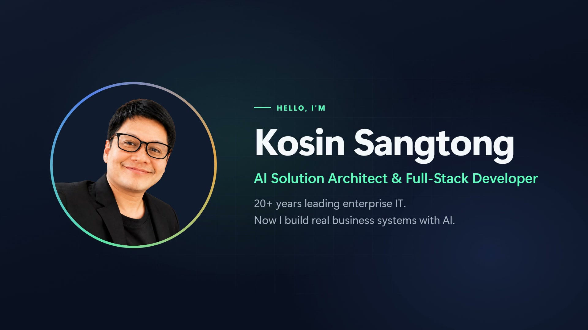

# โกสินทร์ แสงทอง · โปรไฟล์ Fastwork

[English](README.md) · **ภาษาไทย**



ทุกอย่างที่อยู่เบื้องหลังโปรไฟล์ฟรีแลนซ์ของผมที่ **https://fastwork.com/user/kosin** ได้แก่ คลิป showreel ที่เล่นอยู่บนหัวโปรไฟล์ และข้อความจริงที่ลงไว้ในโปรไฟล์ โพสต์ผลงาน 11 โพสต์ และบริการ 5 รายการ คลิปสร้างจากโค้ดด้วย [Remotion](https://www.remotion.dev/) ได้ทั้งภาษาอังกฤษและภาษาไทยจากต้นฉบับเดียว

## ใน repo มีอะไรบ้าง

| ที่อยู่ | คืออะไร |
|---|---|
| `src/` | ตัวคลิป 12 ฉาก 1920x1080 ยาวราว 95 วินาที ทั้งอังกฤษและไทย |
| `src/copy.ts` | ข้อความบนจอทุกบรรทัด ทั้งสองภาษา |
| `src/data.ts` | ภาพหน้าจอที่ใช้ในฉากผลงาน |
| `public/brand/`, `public/shots/` | รูปถ่าย โปสเตอร์ badge ใบรับรอง ปกเพลง และภาพหน้าจอระบบ |
| `fastwork/profile.md` | ข้อความ bio ตำแหน่ง และประสบการณ์ทำงานบนโปรไฟล์ |
| `fastwork/posts/` | โพสต์ผลงาน 11 โพสต์ ทั้ง `posts.json` (คำบรรยายและ tag) และภาพที่อัปขึ้นไป |
| `fastwork/services.json` | บริการ 5 รายการ: คำอธิบาย แพ็กเกจ ราคา tag และโพสต์ที่ผูกไว้ |
| `fastwork/showreel-EN.mp4` | คลิปภาษาอังกฤษตัวที่อัปขึ้น Fastwork (ฉบับ 9.5 MB) |

## เริ่มใช้งาน

```bash
npm install
# วางเพลงพื้นหลังไว้ที่ public/bgm.wav (ไม่ได้ใส่มาใน repo ดูข้อจำกัด)
npx remotion studio src/index.ts                      # ดูตัวอย่าง
npm run render:en                                     # out/kosin-showreel-EN.mp4
npm run render:th                                     # out/kosin-showreel-TH.mp4
```

ถ้าจะตรวจทีละเฟรมให้เร็ว ให้ bundle ครั้งเดียวแล้วเรนเดอร์ภาพนิ่งจาก bundle นั้น

```bash
npx remotion bundle src/index.ts --out-dir=bundle
npx remotion still bundle Showreel-TH th.png --frame=1500
```

## ทำงานอย่างไร

- **ทุกฉากล็อกกับจังหวะเพลง** เพลงพื้นหลังวัดได้ 107.7 BPM เส้นจังหวะเริ่มที่ 0.162 วินาที หนึ่งห้องเพลงยาว 2.229 วินาที ทุกฉากเริ่มตรงห้องเพลงผ่าน `BAR_F()` ใน `src/theme.ts` ไม่มีเลขเฟรมที่เขียนตายตัว
- **ต้นฉบับเดียว สองภาษา** `Showreel-EN` กับ `Showreel-TH` คือ composition เดียวกันที่ส่ง `lang` ต่างกัน ข้อความอยู่ใน `src/copy.ts`
- **ไม่โหลดฟอนต์** ภาษาอังกฤษใช้ Segoe UI Variable ภาษาไทยใช้ Leelawadee UI ทั้งสองตัวเป็นฟอนต์ที่มากับ Windows 11 เพราะการโหลดฟอนต์เว็บด้วย `FontFace` ค้างแบบสุ่มในแท็บเรนเดอร์แท็บหนึ่ง จนเรนเดอร์ทั้งคลิปล้มไป 3 รอบ จึงตั้งใจไม่มีขั้นโหลดฟอนต์
- **กำหนดจุดขึ้นบรรทัดภาษาไทยเอง** Chromium ตัดคำไทยกลางคำ (เช่น คลาวด์ และ นักพัฒนา) ข้อความไทยจึงใช้ `\n` คู่กับ `white-space: pre-line` และไม่ใส่ letter-spacing ให้ตัวอักษรไทยเลย
- **ข้อมูลลูกค้า** ภาพระบบลูกค้าเป็นไฟล์ `*-safe.jpg` ที่เบลอโลโก้ ชื่อบริษัท และชื่อคนไว้แล้ว ภาพที่อาจระบุตัวลูกค้าหรือบุคคลจริงได้ ไม่ได้อยู่ใน repo นี้

## ผลลัพธ์

วัดเมื่อ 17 ตุลาคม 2026 ด้วย `ffprobe` และ `ffmpeg -af ebur128`

| ไฟล์ | ความยาว | ความดัง | เฟรมดำ | เฟรมค้าง |
|---|---|---|---|---|
| อังกฤษ 1920x1080 30 fps | 94.8 วินาที | -18.2 LUFS | 0 | 0 |
| ไทย 1920x1080 30 fps | 94.8 วินาที | -18.2 LUFS | 0 | 0 |

## ข้อจำกัด

- ไม่ได้ใส่เพลงพื้นหลัง (`public/bgm.wav` เพลง "Kosin Explainer Bed") มาใน repo ใช้เพลงที่ 108 BPM แทนได้ ถ้าจังหวะต่างไป ต้องแก้ `BPM` และ `GRID_OFFSET_S` ใน `src/theme.ts`
- ใช้ฟอนต์ระบบ หน้าตาจะตรงเป๊ะเฉพาะบน Windows 11 บนระบบอื่นเบราว์เซอร์จะใช้ฟอนต์ sans-serif ตัวอื่นแทน
- Remotion ใช้ฟรีสำหรับบุคคลและบริษัทที่มีไม่เกิน 3 คน บริษัทที่ใหญ่กว่านั้นต้องซื้อ company license
- รูปถ่าย โปสเตอร์ ปกเพลง และภาพหน้าจอ เป็นผลงานส่วนตัวของผม กรุณาอย่านำไปใช้ต่อ
